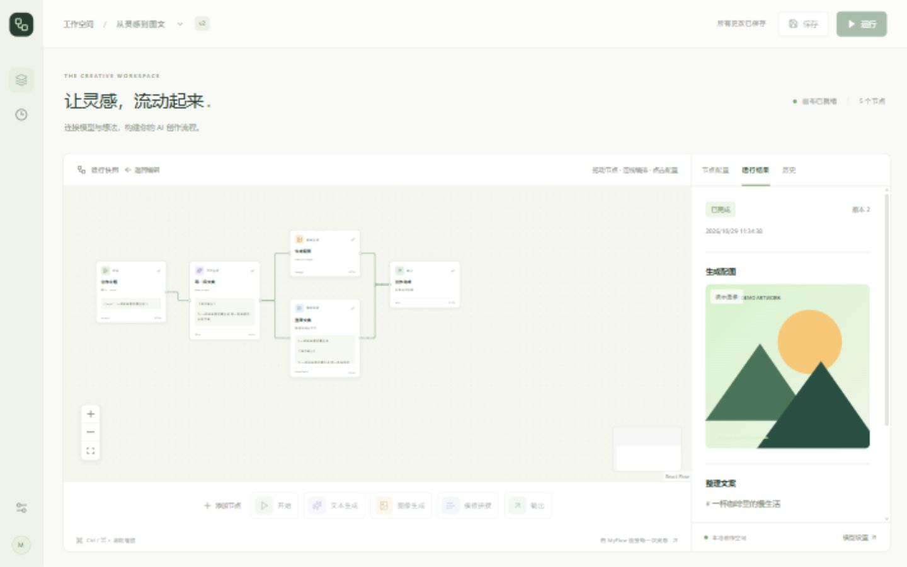

# MyFlow

让灵感，流动起来。一个面向文本与图像生成的可视化 AI 工作流平台。

用节点连接「文本输入 → 文案生成 → 配图与文本整理」，末端节点自动输出，在画布上查看执行状态和流式输出。无需开始或输出节点；填写文本节点后直接点击运行，用 `{{节点ID.output}}` 引用已连接的上游文本。旧版开始/输出节点及历史记录继续兼容。



## 快速开始

安装 Docker Engine 与 Docker Compose 插件（Windows/macOS 可使用 Docker Desktop），在项目根目录运行：

```sh
docker compose up --build -d
```

打开 [http://localhost:3000](http://localhost:3000)，在左下角设置中分别保存 DeepSeek 和 MiniMax 的 API Key，再运行预置的「从灵感到图文」工作流。新预置工作流默认使用 DeepSeek 生成文本、MiniMax 生成图像。也可在两个节点中选择演示模型，无需 API Key；演示文本是固定规则生成，演示配图是本地 SVG，界面会显示演示标记。

```sh
docker compose logs -f
docker compose down
```

数据库、生成文件和加密密钥保存在根目录 `data/`，停止容器后仍然保留。

## 连接真实模型

1. 点击左下角设置按钮，选择「DeepSeek · 文本」，使用默认 Base URL `https://api.deepseek.com` 并保存 DeepSeek API Key。
2. 切换到「MiniMax · 图像」，使用默认 Base URL `https://api.minimax.cn/v1` 并保存 MiniMax API Key。两家连接独立存储，密钥不会混用。
3. 文本节点选择 `DeepSeek Flash`（`deepseek-flash`），图像节点选择 `MiniMax Image-01`（`image-01`）。新节点与新预置工作流默认使用这两个模型；已有工作流和历史快照保留原选择，需在节点面板中切换并保存。
4. 其他模型可在 `backend/models.yaml` 添加，`id` 必须与供应商接受的模型名一致。Compose 已挂载这个文件，修改后刷新页面即可。支持 `deepseek`、`minimax`、`minimax_text`、`openai` 和 `demo` 供应商。

```yaml
models:
  - id: deepseek-flash
    name: DeepSeek Flash
    kind: text          # text 或 image
    provider: deepseek  # 独立使用 DeepSeek 连接
```

DeepSeek 文本使用 `/chat/completions` 流式接口，默认关闭深度思考以直接输出创作文案。MiniMax 图像使用 `/image_generation`，将节点尺寸转换为 `width/height`，请求 base64 并将图片保存到本地 `/artifacts/`；画面描述最多 1500 字符。接口的业务错误码也会作为运行失败处理。

官方接口参考：[DeepSeek](https://api-docs.deepseek.com/)、[MiniMax 文生图](https://platform.minimax.cn/docs/api-reference/image-generation-t2i)。旧的 `openai` 加密配置仍保留，可通过 `/api/provider/get`、`/api/provider/save` 的 `provider: "openai"` 管理；不会自动复制到新的两家服务。

API Key 使用 Fernet 加密，不会通过读取接口返回。首次启动自动生成 `data/encryption.key`；请连同数据库备份，丢失密钥后需重新配置 API Key。设置页中密钥留空会保留已存密钥。也可通过环境变量 `MYFLOW_ENCRYPTION_KEY` 指定有效的 Fernet 密钥；Compose 使用时需自行在 backend 服务中传入该变量。

### MiniMax 模型试验台

打开 [http://localhost:3000/models](http://localhost:3000/models)，或点击工作流左侧的试管图标。试验台提供模型切换、JSON payload 编辑、资源预览、视频任务查询与账户模型查询；每次试用只发送当前模型的一次生成请求，不会自动重试生成。文本、图片、语音、音乐、视频和语音识别同时可在工作流节点使用。

| 能力 | 试验目录 |
| --- | --- |
| 文本（10） | M3.1 Flash、M3、M2.7 / M2.5 / M2.1 及各自 Highspeed、M2、M2-her |
| 图片（2） | Image-01、Image-01 Live；Live 使用宽高比参数 |
| 语音合成（8） | Speech 2.8 / 2.6 / 02 / 01，各含 HD、Turbo |
| 音乐（6） | Music 3.0、2.6、Cover，各含 Free 变体 |
| 视频（13） | H3 / Highspeed / Lite / Max、Hailuo 2.3 / 02 / 2.3 Fast、T2V-01 / Director、I2V-01 / Director / Live、S2V-01 |
| 语音识别（1） | ASR 1.0；通过 JSON 中的 Base64 文件转为供应商 multipart 请求，试验台上传上限 20 MB |

目录包含历史型号，列出不代表账户仍可调用；请以真实响应为准。部分 M2 型号虽仍出现在官方账户模型列表中，实际调用已返回不可用；音乐 API 对新账户可能返回 HTTP 410。参考官方[接口目录](https://platform.minimax.cn/docs/llms.txt)、[文本调试台](https://solutions.minimax.cn/debug/text)、[语音调试台](https://solutions.minimax.cn/debug/speech)。

MiniMax 多模态连接使用按量 API Key。需要 M Plan Key 的文本模型可在设置中填写「MiniMax · 文本专用（可选）」（`provider: "minimax_text"`），未配置时复用 `minimax`。历史型号是否开放、限免版本是否可用均由供应商账户决定。

所有业务请求仍为 POST，ID 等参数在 JSON 中：

| 地址 | payload / 用途 |
| --- | --- |
| `/api/minimax/catalog` | `{}`：模型及示例 payload，不调用供应商 |
| `/api/minimax/discover` | `{}`：从供应商获取当前密钥可见的文本模型 |
| `/api/minimax/trial` | `{"model":"image-01","payload":{"prompt":"一杯咖啡","aspect_ratio":"1:1","n":1,"response_format":"base64"}}` |
| `/api/minimax/video/query` | `{"task_id":"任务ID","api_version":"v2"}`；H3 用 v2，Hailuo/T2V/I2V/S2V 用 v1 |
| `/api/minimax/checks` | `{}`：读取本机最近一次批量实测报告，未运行过则为空 |

图片 Base64 和音频 hex 会保存到 `/artifacts/`；供应商返回的视频等 URL 为临时链接。图生图、视频参考图/音频等高级输入可直接按所选模型官方文档补入 JSON。翻唱需 `audio_url` / `audio_base64` / `cover_feature_id`；图生视频需 `first_frame_image`，S2V 需 `subject_reference`。语音识别在试验台上传文件即可。音色复刻、音色设计及视频 Agent 等专项工具不属于本次模型试验入口。

批量真实试调脚本（使用本地已加密保存的密钥，会按供应商计费）：

```powershell
conda activate myflow
python -X utf8 scripts/check_minimax_models.py
# 只重试被 RPM 限流的请求，并查询未完成的视频，不重复生成已成功条目
python -X utf8 scripts/check_minimax_models.py --resume
```

结果保存在 `docs/minimax-model-check.json`，包含每款模型的状态、耗时、输出资源和视频任务 ID，不含密钥。该本机生成文件已被 Git 忽略。试验台的「载入批量实测」可预览结果。新部署不会自动执行付费试调；Docker 镜像不包含本机实测文件。

## 使用画布

新节点库包含文本输入、文本生成、图像生成、语音合成、音乐生成、视频生成、语音识别、模板拼接八类节点；旧开始/输出节点继续显示和运行。

| 新节点 | 配置与连接 |
| --- | --- |
| 语音合成 | 选择 Speech 模型、音色 ID 和语速，朗读文本可引用上游；输出本地音频 |
| 音乐生成 | 配置风格、歌词或纯音乐；Cover 模型可上传参考音频，或引用上游音频 URL |
| 视频生成 | 选择模型、时长、分辨率和等待时限；可上传首帧 / 人物参考图，或引用图像节点；完成后输出视频链接 |
| 语音识别 | 上传音频，或引用上游语音 / 音乐的本地资源；识别文本可继续交给文本、模板等节点 |

例如：`文本输入 → 语音合成 → 语音识别 → 模板`，以及 `文本输入 → 图像生成 → 视频生成`，末端自动输出。媒体节点用 `{{节点ID.url}}` 引用资源，文本 / 识别节点用 `{{节点ID.output}}` 引用文本。通过连线建立依赖后，参数框中的「插入上游变量」会列出可用字段。

资源上传使用 `POST /api/artifacts/upload`，payload 为 `{"file_name":"audio.mp3","file_base64":"…"}`；音频和图片最大 20 MB。资源保存在数据目录，工作流仅保存 URL，不将 Base64 写入图快照。识别节点读取本地已上传或已生成的音频，不从任意远程地址下载文件；视频输入图片会将本地资源转换为供应商可读取的 Data URL。

视频节点仅提交一次生成任务，随后查询状态；任务 ID 会显示在节点运行详情中，并可跳转试验台继续查询。切换视频模型时自动调整默认时长和分辨率，仍需满足各模型的输入要求。超时、连续查询错误或取消运行会停止本地等待，上游任务可能继续；请凭已有任务 ID 查询，避免重复生成。音乐等模型的供应商开放限制仍然适用。

可运行 `python -X utf8 scripts/check_media_workflow.py` 创建独立的「多模态节点验证：语音识别与图生视频」工作流并真实调用语音、识别、图片和视频模型。它使用已有连接，会产生供应商调用费用；本机结果写入已被 Git 忽略的 `docs/media-workflow-check.json`。

- 点击底部节点按钮添加，或将它拖到画布中。从节点右侧圆点拖向下游节点左侧圆点完成连线。
- 点击节点，在右侧配置模型和提示词。点击空白区域可修改工作流名称。
- 提示词支持 `{{node_id.output}}`；开始节点的输入可通过 `{{start.topic}}` 引用。输入 `{` 或点击「插入上游变量」查看已连接的上游变量。
- 新工作流直接填写「文本输入」节点，使用 `{{节点ID.output}}` 引用原文；点击运行即可。旧开始节点的字段仍用逗号分隔，例如 `topic,style`，旧工作流运行时保留输入表单。
- 选中节点或连线，按 Delete / Backspace 删除；节点也可在配置面板中删除。
- 运行时会先保存当前工作流。图必须非空且无循环，允许多个文本源、独立分支及多个末端；不再要求开始或输出节点。
- 文本可连接文本生成、图片、语音、音乐、视频与模板等处理节点；媒体仍遵守类型约束，图片可接视频，音频可接识别或翻唱，视频作为末端。
- 所有末端节点自动成为最终结果；旧输出节点继续展开其直接上游结果。点击节点可查看输入、输出、耗时和供应商返回的 token 用量。
- 运行结果页可以停止当前运行。历史页显示最近 50 次运行，点击记录会重放事件并展示当时的画布快照；点击「返回编辑」继续编辑。
- SSE 通过 POST 流式读取，断线会自动重连，使用 payload 中的 `after` 事件 ID 从断点继续。刷新页面后，可从历史页重新打开正在运行的记录。

### API 调用约定

本项目 `/api/` 业务接口统一使用 **POST + JSON payload**，ID 等参数放在请求体中。资源文件 `/artifacts/*`、接口文档 `/docs`、`/redoc` 和 `/openapi.json` 保留 GET；页面及前端静态资源照常使用 GET。以下地址由后端直接提供，前端开发代理转发 `/api/*` 和 `/artifacts/*`。

| 操作 | POST 地址 | payload |
| --- | --- | --- |
| 健康检查、节点定义、模型列表 | `/api/health`、`/api/nodes`、`/api/models` | `{}` |
| 读取模型连接 | `/api/provider/get` | `{"provider":"deepseek"}` 或 `{"provider":"minimax"}` |
| 保存模型连接 | `/api/provider/save` | `{"provider":"deepseek","base_url":"https://api.deepseek.com","api_key":"…"}`（MiniMax 使用 `provider:"minimax"` 及其地址与密钥） |
| 工作流列表 | `/api/workflows/list` | `{}` |
| 创建工作流 | `/api/workflows` | `{"name":"名称","graph":{"nodes":[],"edges":[]}}` |
| 读取工作流 | `/api/workflows/get` | `{"id":"工作流ID"}` |
| 保存工作流 | `/api/workflows/save` | `{"id":"工作流ID","name":"名称","graph":{"nodes":[],"edges":[]},"version":1}` |
| 删除工作流 | `/api/workflows/delete` | `{"id":"工作流ID"}` |
| 启动运行 | `/api/workflows/runs` | `{"id":"工作流ID","inputs":{"topic":"主题"}}` |
| 运行历史 | `/api/workflows/runs/list` | `{"id":"工作流ID"}` |
| 运行详情、取消运行 | `/api/runs/get`、`/api/runs/cancel` | `{"id":"运行ID"}` |
| 运行事件流 | `/api/runs/events` | `{"id":"运行ID","after":0}` |

事件流仍返回 `text/event-stream`，`after` 可省略（默认 0）。例如在 PowerShell 中查看实时事件：

```powershell
'{"id":"替换为运行ID","after":0}' | curl.exe -N -X POST "http://127.0.0.1:8000/api/runs/events" -H "Content-Type: application/json" --data-binary '@-'
```

此约定替换旧的 GET/PUT/DELETE 业务路由及带 ID 的 URL，外部调用方也需同步更新。上游模型服务仍按供应商协议调用。

## 本地开发

项目使用 Node.js 24.19.0（根目录 `.nvmrc`）、Python 3.12 和 pnpm 10.18.3（`frontend/package.json`）。Docker 同样使用 Node.js 24 系列。

### 首次准备：nvm + Conda

以下命令在项目根目录执行一次即可。`environment.yml` 会创建独立 Python 环境并安装后端运行、测试依赖，Conda base 环境只用于管理环境。

将环境放在项目根目录的 `.conda/` 中，使用相对路径，不依赖固定盘符。该目录已被 Git 忽略：

```powershell
conda env create --prefix ./.conda --file environment.yml
```

已有按环境名创建的 `myflow` 环境，可继续用 `conda activate myflow` 激活；使用下面的相对路径启动方式前，需要先创建一次项目内的 `.conda/` 环境。

安装前端工具及锁定依赖：

```powershell
nvm install 24.19.0
nvm use 24 --local
cd frontend
npm install --global pnpm@10.18.3
pnpm install --frozen-lockfile
```

`nvm use 24 --local` 从本地已安装的 24.x 版本中选择最新版本，不读取在线版本列表。本项目已验证版本为 24.19.0。普通 `nvm use <版本>` 可能先联网解析版本，下载源不可达时会超时。

前端 `.npmrc` 将 pnpm 包存储放到项目根目录 `.pnpm-store/`，该目录已被 Git 忽略。新安装 nvm 或修改 PATH 后，重开终端；若编辑器内仍找不到命令，请重启编辑器。

### 日常启动

终端一，从项目根目录激活环境并启动后端：

```powershell
conda activate ./.conda
cd backend
python -m uvicorn app.main:app --host 127.0.0.1 --port 8000 --reload
```

终端二，从项目根目录启动前端：

```powershell
cd frontend
pnpm dev
```

每个新后端终端都需要激活 Conda；环境和依赖无需重新安装。Node 保持 24 为默认版本时无需再次切换；从其他版本切回时执行 `nvm use 24 --local`。本机 nvm 使用 link 模式，不会根据 `.nvmrc` 自动切换；shim 模式则支持自动识别。

若 PowerShell 尚未初始化 Conda，可在 `backend/` 中直接启动，无需修改 PowerShell 配置：

```powershell
conda run --no-capture-output --prefix ../.conda python -m uvicorn app.main:app --host 127.0.0.1 --port 8000 --reload
```

前端将 `/api` 和 `/artifacts` 代理到 `http://127.0.0.1:8000`，无需配置 CORS。若改变后端地址，在启动前端前设置 `BACKEND_URL`；生产构建需在 `pnpm build` 前设置。

后端 API 文档：[http://127.0.0.1:8000/docs](http://127.0.0.1:8000/docs)。本地开发默认数据目录是 `backend/data/`，可通过 `MYFLOW_DATA_DIR` 指定。

### 一次性修复 nvm 目录

若 `nvm list` 显示没有版本，但 `D:/Programs/nvm/installs/v24.19.0/node.exe` 确实存在，请在**报错的同一个终端**、项目根目录运行：

```powershell
.\scripts\repair-local-nvm.ps1
```

脚本先验证现有 Node 文件，再修正当前终端读取的 nvm 配置（版本目录、link 模式），并更新当前终端和用户 PATH；不会下载 Node 或修改 Conda 环境。默认版本目录为 `D:/Programs/nvm/installs`，命令通过 nvm 管理的 `D:/Programs/nvm/.link/nodejs` 链接访问所选版本。

**修复成功后无需每次执行。** 重开其他终端或编辑器即可刷新 PATH。可通过脚本参数 `-VersionRoot`、`-Version` 指定其他安装目录和版本；脚本针对 nvm-windows 2.x。

### 更新依赖与验证

后端依赖变化时，在项目根目录更新已有环境；前端依赖变化时，在 `frontend/` 中重新运行 `pnpm install --frozen-lockfile`：

```powershell
conda env update --prefix ./.conda --file environment.yml
```

```sh
# backend/（激活虚拟环境后）
python -m pytest -q

# frontend/
pnpm test
pnpm typecheck
pnpm build
```

### 不使用 Conda：venv 备选

在 `backend/` 中运行 `python -m venv .venv`，激活后执行 `python -m pip install -r requirements-dev.txt`，再按上述方式启动后端。Windows PowerShell 激活命令为 `.venv\Scripts\Activate.ps1`，macOS/Linux 为 `source .venv/bin/activate`。前端工具和启动步骤相同。

## 当前边界

### 行为规范与统一验收

项目行为、测试映射及覆盖边界见 [SPEC.md](SPEC.md)，后续开发遵循 [AGENTS.md](AGENTS.md)。安装开发依赖后，在根目录运行 `python scripts/verify.py`，依次检查后端测试、前端测试、类型和生产构建；任一步失败即返回非零。终端无 Python 时可用 `.\backend\.venv\Scripts\python.exe scripts/verify.py`，也可通过 `--python` 指定后端解释器。验收使用临时数据和模拟供应商，不运行付费试调脚本；浏览器人工验收项单独列在规范中。

这是单机、单用户 MVP，默认仅通过本机 `127.0.0.1:3000` 访问，未提供登录鉴权。后端依靠进程内 asyncio 调度，必须使用一个 Uvicorn worker。每次运行中的独立节点最多并发执行 4 个；失败会取消同次运行的其他任务，并记录未执行节点。服务重启后，未完成运行会标记为中断，可以重新发起。

运行历史保存工作流版本、图快照及事件；编辑冲突返回 409。当前不支持版本回滚、失败续跑和条件分支。图像接口返回 base64 时会保存到本地；返回 URL 时保留供应商链接，可能过期，请及时保存。

完整方案与后续范围见 [DESIGN.md](DESIGN.md)。
